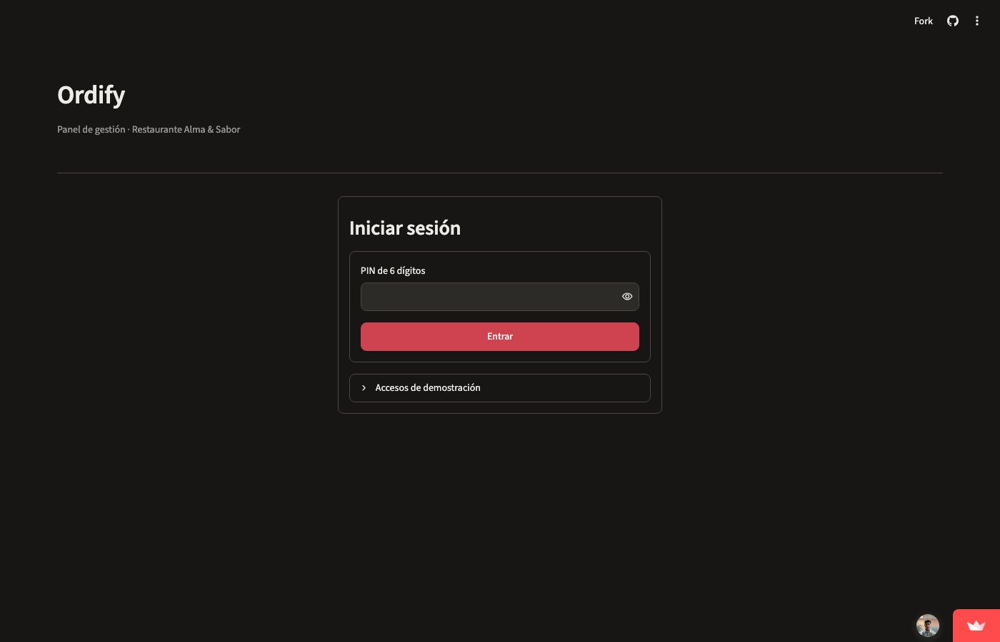

# Ordify — Restaurant Management System

Web application to run a restaurant from a single screen: waiters take orders per table, each kitchen station and the bar see only their own queue, and the admin manages bills and inventory. The interface is in Spanish.

**[Open the live app →](https://alex-calva-ordify.streamlit.app)** · Demo PINs are listed on the login screen.

## Features

- **PIN-based login with roles:** admin, waiter, Italian chef, Mexican chef and barista.
- **Tables:** register tables with their number of diners.
- **Orders:** several products from any category in a single order. Stock is deducted when the order is placed and returned if an admin deletes it.
- **Station queues:** each kitchen station and the bar see only the pending items that belong to them and mark them as sent.
- **Inventory:** live stock and prices per category.
- **Bills:** itemized bill per table, total and split per diner, with a two-step confirmation before closing the table.

## Tech Stack

Python · Streamlit · Streamlit Community Cloud

## Source Code

The source code is kept in a private repository. It can be shared on request.

---

> University project, ITSOEH.

**Author:** Rembrandt Alexander Calva Obregón · [Portfolio](https://alex-calva.github.io) · [LinkedIn](https://www.linkedin.com/in/alex-calva)
